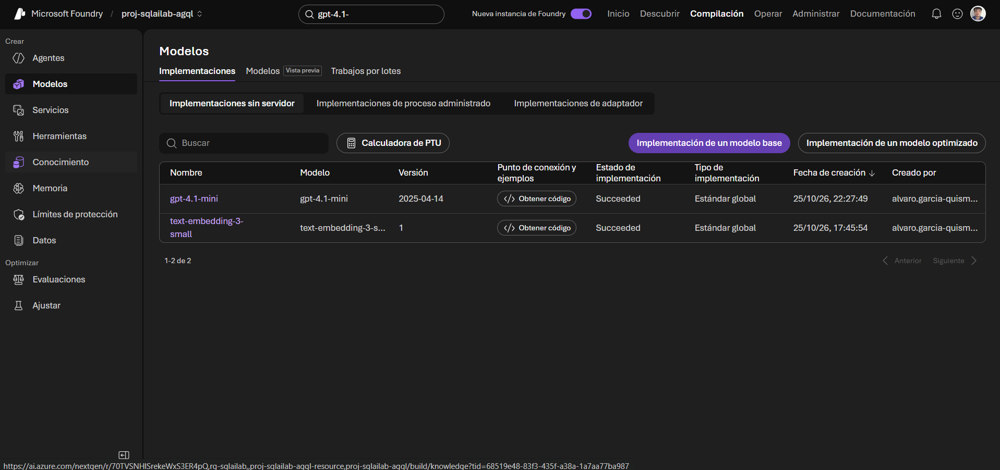
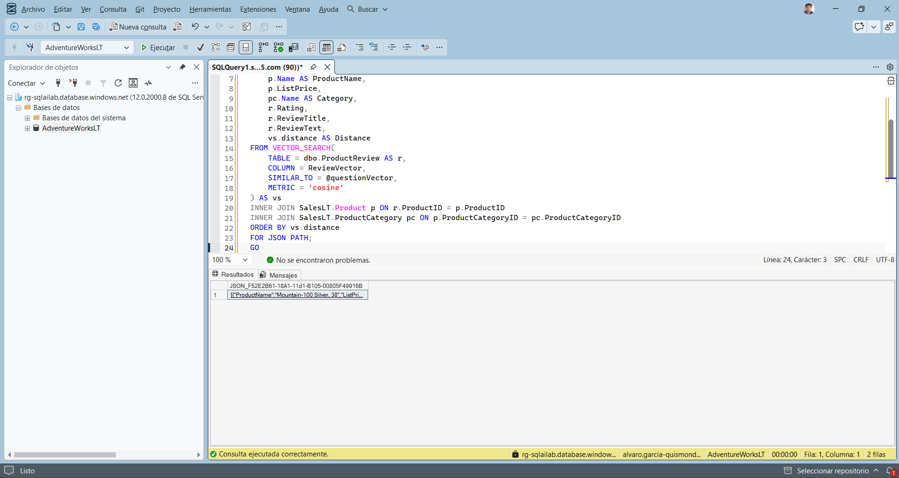
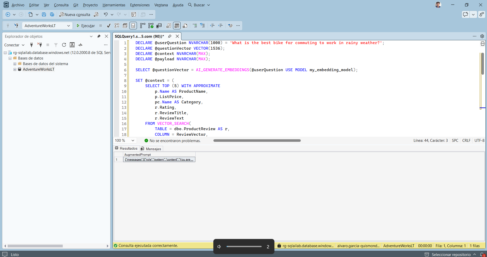
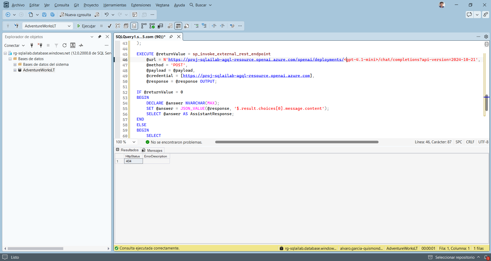
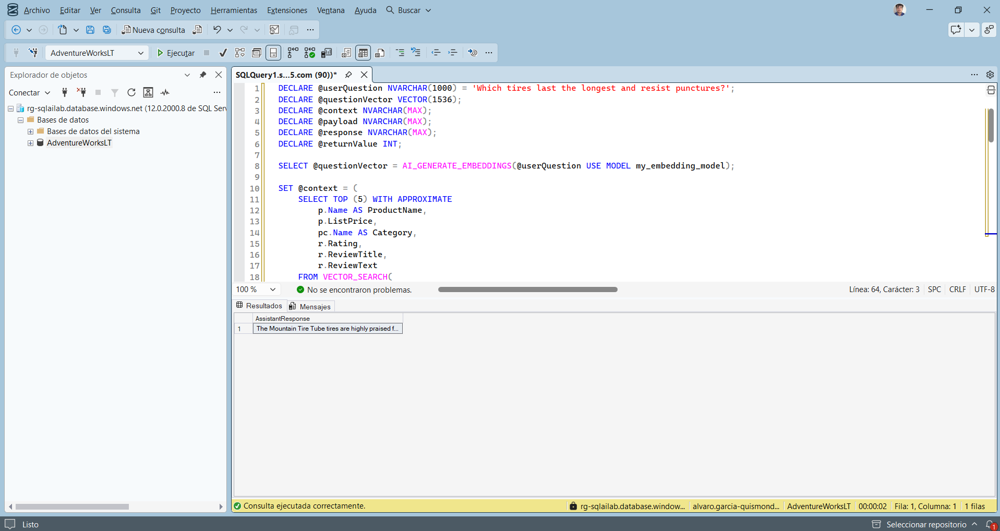
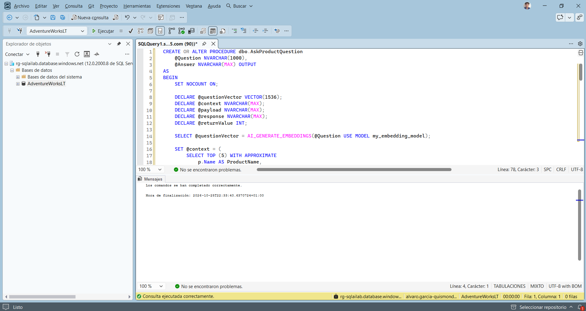
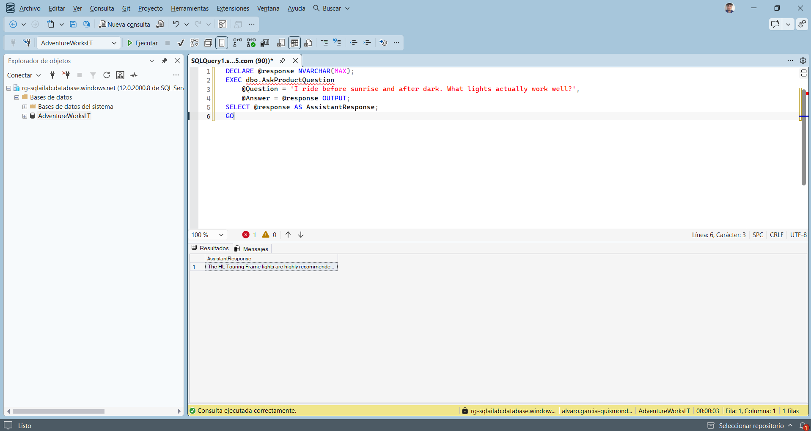
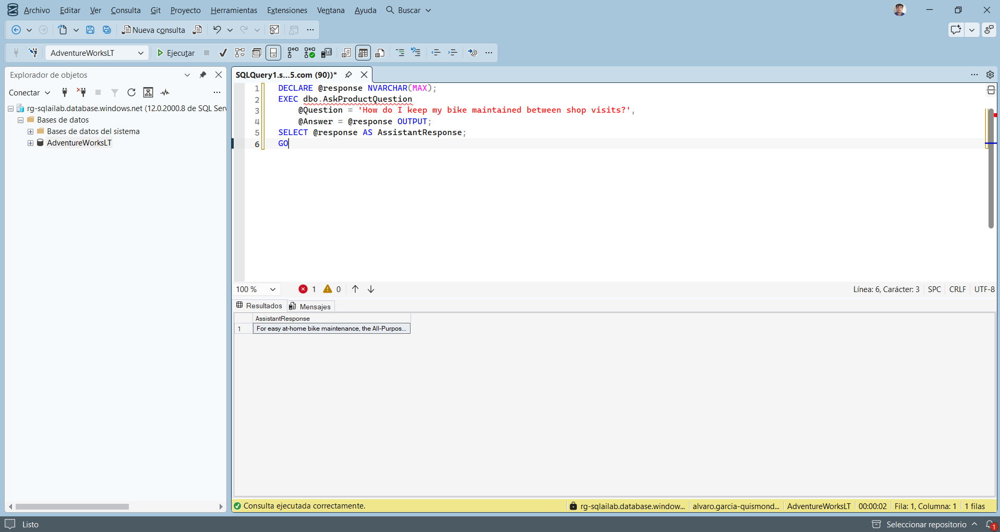

# Solución RAG con Azure SQL Database y Azure OpenAI

Implement RAG solutions

Álvaro García-Quismondo Lizana · 25 de octubre de 2026

## Contenido

- 1. Objetivo y punto de partida
- 2. Modelo de chat
- 3. Recuperación de reseñas como JSON
- 4. Prompt aumentado
- 5. Generación de la respuesta
- 6. Procedimiento almacenado
- 7. Pruebas del procedimiento
- 8. Resumen de incidencias
- 9. Observaciones
- 10. Scripts incluidos

## 1. Objetivo y punto de partida

En esta práctica monto una solución RAG (Retrieval Augmented Generation) dentro de Azure SQL Database. La idea es que el modelo de lenguaje no conteste de memoria sino con datos de mi base: para cada pregunta busco las reseñas más relevantes con búsqueda vectorial, las paso al modelo como contexto y genero la respuesta a partir de ellas.

El proceso tiene cinco pasos, todos en T-SQL: convertir la pregunta en un embedding, recuperar las 5 reseñas más cercanas con `VECTOR_SEARCH`, darles formato JSON, construir el prompt aumentado con un mensaje de sistema y llamar a Azure OpenAI con `sp_invoke_external_rest_endpoint`. Al final lo empaqueto todo en un procedimiento almacenado reutilizable.

Parto del trabajo de la práctica anterior (búsqueda de texto completo, vectorial e híbrida). Ya existían la tabla `dbo.ProductReview` con 140 reseñas y su columna `ReviewVector` con los embeddings, el índice DiskANN, la credencial con identidad administrada y el modelo externo `my_embedding_model`. Por eso no repito el aprovisionamiento ni la carga de datos y solo compruebo que siguen en su sitio.

| Elemento | Valor |
|---|---|
| Suscripción | Azure for Students |
| Grupo de recursos | rg-sqlailab |
| Servidor y base de datos | rg-sqlailab / AdventureWorksLT (Spain Central, autenticación Microsoft Entra) |
| Recurso de Azure OpenAI | proj-sqlailab-agql-resource |
| Modelo de embeddings | text-embedding-3-small (my_embedding_model) |
| Modelo de chat | gpt-4.1-mini, despliegue Estándar global |
| Cliente SQL | SQL Server Management Studio |

```sql
SELECT COUNT(*) AS TotalReviews, COUNT(ReviewVector) AS ReviewsWithEmbeddings
FROM dbo.ProductReview;
GO

SELECT 'Credencial' AS Objeto, name FROM sys.database_scoped_credentials
UNION ALL
SELECT 'Modelo externo', name FROM sys.external_models;
GO
```

La consulta debe devolver 140 reseñas con embedding, la credencial y el modelo externo, que es el estado en que dejé la práctica anterior. Los scripts de preparación están en el zip de esa práctica.

## 2. Modelo de chat

El enunciado usa el despliegue gpt-5.4-mini para la generación. En mi suscripción Azure for Students ese modelo no tiene cuota (ya me había pasado en la práctica anterior, donde no hacía falta), pero esta vez sí necesito un modelo de chat porque la última fase llama a un endpoint de chat completions.

Desplegué gpt-4.1-mini con la configuración por defecto y sin cambiar el nombre del despliegue. Aparece como Succeeded, de tipo Estándar global, junto al de embeddings. El único cambio en los scripts respecto al enunciado es el nombre del despliegue en la URL: `gpt-4.1-mini` en lugar de `gpt-5.4-mini`.



*Figura 1. Despliegues del proyecto: gpt-4.1-mini y text-embedding-3-small, ambos Succeeded.*

## 3. Recuperación de reseñas como JSON

Esta es la fase de recuperación. La pregunta se convierte en un embedding con el mismo modelo que se usó para las reseñas, y `VECTOR_SEARCH` busca en el índice DiskANN las 5 reseñas más cercanas. Con `FOR JSON PATH` el resultado sale como una cadena JSON que luego se puede insertar en el prompt.

El enunciado escribe `TOP_N = 5` dentro de `VECTOR_SEARCH`. Como ya me ocurrió en la práctica anterior, con la versión nueva del índice vectorial ese parámetro devuelve el error 42274. Apliqué desde el principio la forma que sí funciona: `SELECT TOP (5) WITH APPROXIMATE` con un `ORDER BY vs.distance`. Lo mismo vale para las otras tres consultas del laboratorio que usan `VECTOR_SEARCH`.

```sql
DECLARE @userQuestion NVARCHAR(1000) = 'What mountain bike can handle really technical rocky trails?';
DECLARE @questionVector VECTOR(1536);

SELECT @questionVector = AI_GENERATE_EMBEDDINGS(@userQuestion USE MODEL my_embedding_model);

SELECT TOP (5) WITH APPROXIMATE
    p.Name AS ProductName,
    p.ListPrice,
    pc.Name AS Category,
    r.Rating,
    r.ReviewTitle,
    r.ReviewText,
    vs.distance AS Distance
FROM VECTOR_SEARCH(
    TABLE = dbo.ProductReview AS r,
    COLUMN = ReviewVector,
    SIMILAR_TO = @questionVector,
    METRIC = 'cosine'
) AS vs
INNER JOIN SalesLT.Product p ON r.ProductID = p.ProductID
INNER JOIN SalesLT.ProductCategory pc ON p.ProductCategoryID = pc.ProductCategoryID
ORDER BY vs.distance
FOR JSON PATH;
GO
```

El resultado es una sola fila con una columna que contiene el JSON. En la celda se lee el principio: una lista de objetos que empieza por «Mountain-100 Silver, 38» con su precio, categoría, valoración, título y texto de la reseña.



*Figura 2. Resultado de la recuperación: una fila con las 5 reseñas en formato JSON.*

## 4. Prompt aumentado

Ahora construyo la parte «augmented» de RAG. El contexto recuperado se guarda en `@context` y se arma el cuerpo de la petición con `JSON_OBJECT` y `JSON_ARRAY`, siguiendo el formato de la API de chat completions: dos mensajes y los parámetros `max_tokens` (500) y `temperature` (0,5).

- El mensaje de sistema (system) fija el comportamiento: responder solo con las reseñas y datos proporcionados, citar experiencias concretas de clientes y decir que no hay información suficiente si el contexto no la tiene.
- El mensaje de usuario (user) lleva el JSON de reseñas seguido de la pregunta del cliente.
- Si la búsqueda no devuelve nada, `ISNULL(@context, '[]')` evita que el prompt se rompa.

```sql
DECLARE @userQuestion NVARCHAR(1000) = 'What is the best bike for commuting to work in rainy weather?';
DECLARE @questionVector VECTOR(1536);
DECLARE @context NVARCHAR(MAX);
DECLARE @payload NVARCHAR(MAX);

SELECT @questionVector = AI_GENERATE_EMBEDDINGS(@userQuestion USE MODEL my_embedding_model);

SET @context = (
    SELECT TOP (5) WITH APPROXIMATE
        p.Name AS ProductName,
        p.ListPrice,
        pc.Name AS Category,
        r.Rating,
        r.ReviewTitle,
        r.ReviewText
    FROM VECTOR_SEARCH(
        TABLE = dbo.ProductReview AS r,
        COLUMN = ReviewVector,
        SIMILAR_TO = @questionVector,
        METRIC = 'cosine'
    ) AS vs
    INNER JOIN SalesLT.Product p ON r.ProductID = p.ProductID
    INNER JOIN SalesLT.ProductCategory pc ON p.ProductCategoryID = pc.ProductCategoryID
    ORDER BY vs.distance
    FOR JSON PATH
);

SET @payload = JSON_OBJECT(
    'messages': JSON_ARRAY(
        JSON_OBJECT(
            'role': 'system',
            'content': 'You are an Adventure Works product assistant. Answer questions using only the provided product reviews and data. Mention specific customer experiences from the reviews when relevant. Be concise and helpful. If the data does not contain enough information, say so.'
        ),
        JSON_OBJECT(
            'role': 'user',
            'content': 'Product reviews: ' + ISNULL(@context, '[]') + CHAR(10) + CHAR(10) + 'Customer question: ' + @userQuestion
        )
    ),
    'max_tokens': CAST(500 AS INT),
    'temperature': 0.5
);

SELECT @payload AS AugmentedPrompt;
GO
```

El `SELECT @payload` muestra el prompt completo. En la celda se lee el comienzo, con el mensaje de sistema «You are an Adventure Works product assistant».



*Figura 3. Prompt aumentado generado con la pregunta sobre ir al trabajo en bici con lluvia.*

## 5. Generación de la respuesta

Esta es la fase de generación. El script repite la recuperación y la construcción del prompt con una pregunta nueva y envía el cuerpo al despliegue `gpt-4.1-mini` con `sp_invoke_external_rest_endpoint`. La autenticación usa la misma credencial con identidad administrada de la práctica anterior, así que no hay claves en el código. Si la llamada devuelve 0, la respuesta se extrae de `$.result.choices[0].message.content`; en otro caso se muestra el código HTTP y su descripción.

### 5.1 Incidencia: error 404

En la primera ejecución el resultado fue HttpStatus 404 con la descripción vacía. En la URL escribí el nombre del despliegue como `<gpt-4.1-mini>`: sustituí el texto del marcador pero dejé los símbolos `<` y `>`, así que Azure buscaba un despliegue con ese nombre literal y no lo encontraba.



*Figura 4. HttpStatus 404 por dejar los símbolos < > alrededor del nombre del despliegue.*

### 5.2 Versión correcta

Con el nombre sin los símbolos la llamada funciona. La pregunta es qué neumáticos duran más y resisten los pinchazos. La respuesta del modelo empieza hablando de «Mountain Tire Tube» como altamente valorado. La consulta completa, con la llamada al modelo, tardó 2 segundos.

```sql
DECLARE @userQuestion NVARCHAR(1000) = 'Which tires last the longest and resist punctures?';
DECLARE @questionVector VECTOR(1536);
DECLARE @context NVARCHAR(MAX);
DECLARE @payload NVARCHAR(MAX);
DECLARE @response NVARCHAR(MAX);
DECLARE @returnValue INT;

SELECT @questionVector = AI_GENERATE_EMBEDDINGS(@userQuestion USE MODEL my_embedding_model);

SET @context = (
    SELECT TOP (5) WITH APPROXIMATE
        p.Name AS ProductName,
        p.ListPrice,
        pc.Name AS Category,
        r.Rating,
        r.ReviewTitle,
        r.ReviewText
    FROM VECTOR_SEARCH(
        TABLE = dbo.ProductReview AS r,
        COLUMN = ReviewVector,
        SIMILAR_TO = @questionVector,
        METRIC = 'cosine'
    ) AS vs
    INNER JOIN SalesLT.Product p ON r.ProductID = p.ProductID
    INNER JOIN SalesLT.ProductCategory pc ON p.ProductCategoryID = pc.ProductCategoryID
    ORDER BY vs.distance
    FOR JSON PATH
);

SET @payload = JSON_OBJECT(
    'messages': JSON_ARRAY(
        JSON_OBJECT(
            'role': 'system',
            'content': 'You are an Adventure Works product assistant. Answer questions using only the provided product reviews and data. Mention specific customer experiences from the reviews when relevant. Be concise and helpful. If the data does not contain enough information, say so.'
        ),
        JSON_OBJECT(
            'role': 'user',
            'content': 'Product reviews: ' + ISNULL(@context, '[]') + CHAR(10) + CHAR(10) + 'Customer question: ' + @userQuestion
        )
    ),
    'max_tokens': CAST(500 AS INT),
    'temperature': 0.5
);

EXECUTE @returnValue = sp_invoke_external_rest_endpoint
    @url = N'https://proj-sqlailab-agql-resource.openai.azure.com/openai/deployments/gpt-4.1-mini/chat/completions?api-version=2024-10-21',
    @method = 'POST',
    @payload = @payload,
    @credential = [https://proj-sqlailab-agql-resource.openai.azure.com],
    @response = @response OUTPUT;

IF @returnValue = 0
BEGIN
    DECLARE @answer NVARCHAR(MAX);
    SET @answer = JSON_VALUE(@response, '$.result.choices[0].message.content');
    SELECT @answer AS AssistantResponse;
END
ELSE
BEGIN
    SELECT
        @returnValue AS HttpStatus,
        JSON_VALUE(@response, '$.response.status.http.description') AS ErrorDescription;
END
GO
```



*Figura 5. Respuesta del modelo a la pregunta sobre neumáticos duraderos.*

## 6. Procedimiento almacenado

Para que una aplicación pueda usar todo esto sin repetir el código, lo agrupo en `dbo.AskProductQuestion`, con la pregunta como parámetro de entrada y la respuesta como parámetro de salida. Respecto al script anterior añade tres cosas:

- Si la búsqueda no devuelve contexto, responde con un mensaje y termina sin llamar al modelo.
- El mensaje de sistema pasa a ser una lista de reglas: usar solo las reseñas, citar experiencias concretas, incluir las valoraciones en estrellas, no pasar de 150 palabras y sugerir productos relacionados.
- Los errores de la llamada se traducen a mensajes: 429 (servicio ocupado), 401 y 403 (fallo de autenticación) y cualquier otro código con su número.

```sql
CREATE OR ALTER PROCEDURE dbo.AskProductQuestion
    @Question NVARCHAR(1000),
    @Answer NVARCHAR(MAX) OUTPUT
AS
BEGIN
    SET NOCOUNT ON;

    DECLARE @questionVector VECTOR(1536);
    DECLARE @context NVARCHAR(MAX);
    DECLARE @payload NVARCHAR(MAX);
    DECLARE @response NVARCHAR(MAX);
    DECLARE @returnValue INT;

    SELECT @questionVector = AI_GENERATE_EMBEDDINGS(@Question USE MODEL my_embedding_model);

    SET @context = (
        SELECT TOP (5) WITH APPROXIMATE
            p.Name AS ProductName,
            p.ListPrice,
            pc.Name AS Category,
            r.Rating,
            r.ReviewTitle,
            r.ReviewText
        FROM VECTOR_SEARCH(
            TABLE = dbo.ProductReview AS r,
            COLUMN = ReviewVector,
            SIMILAR_TO = @questionVector,
            METRIC = 'cosine'
        ) AS vs
        INNER JOIN SalesLT.Product p ON r.ProductID = p.ProductID
        INNER JOIN SalesLT.ProductCategory pc ON p.ProductCategoryID = pc.ProductCategoryID
        ORDER BY vs.distance
        FOR JSON PATH
    );

    IF @context IS NULL
    BEGIN
        SET @Answer = 'No reviews found matching your query. Please try a different question.';
        RETURN;
    END

    SET @payload = JSON_OBJECT(
        'messages': JSON_ARRAY(
            JSON_OBJECT(
                'role': 'system',
                'content': 'You are an Adventure Works product assistant. Follow these rules:
1. Answer only using the provided product reviews and data
2. Reference specific customer experiences from the reviews when relevant
3. Include star ratings to help the customer assess product quality
4. Keep responses under 150 words
5. Suggest related products when relevant'
            ),
            JSON_OBJECT(
                'role': 'user',
                'content': 'Product reviews: ' + @context + CHAR(10) + CHAR(10) + 'Customer question: ' + @Question
            )
        ),
        'max_tokens': CAST(500 AS INT),
        'temperature': 0.5
    );

    EXECUTE @returnValue = sp_invoke_external_rest_endpoint
        @url = N'https://proj-sqlailab-agql-resource.openai.azure.com/openai/deployments/gpt-4.1-mini/chat/completions?api-version=2024-10-21',
        @method = 'POST',
        @payload = @payload,
        @credential = [https://proj-sqlailab-agql-resource.openai.azure.com],
        @response = @response OUTPUT;

    IF @returnValue = 0
        SET @Answer = JSON_VALUE(@response, '$.result.choices[0].message.content');
    ELSE IF @returnValue = 429
        SET @Answer = 'The service is currently busy. Please try again in a moment.';
    ELSE IF @returnValue IN (401, 403)
        SET @Answer = 'Authentication failed. Please check the credential configuration.';
    ELSE
        SET @Answer = 'Unable to process your question at this time. HTTP status: ' + CAST(@returnValue AS NVARCHAR(10));
END;
GO
```



*Figura 6. Procedimiento dbo.AskProductQuestion creado correctamente.*

## 7. Pruebas del procedimiento

Probé el procedimiento con tres preguntas distintas. Cada una repite el ciclo completo: embedding de la pregunta, recuperación de 5 reseñas, prompt aumentado y respuesta del modelo. Las tres tardaron entre 2 y 3 segundos.

```sql
DECLARE @response NVARCHAR(MAX);

EXEC dbo.AskProductQuestion
    @Question = 'I ride before sunrise and after dark. What lights actually work well?',
    @Answer = @response OUTPUT;

SELECT @response AS AssistantResponse;
GO

DECLARE @response NVARCHAR(MAX);

EXEC dbo.AskProductQuestion
    @Question = 'How do I keep my bike maintained between shop visits?',
    @Answer = @response OUTPUT;

SELECT @response AS AssistantResponse;
GO

DECLARE @response NVARCHAR(MAX);

EXEC dbo.AskProductQuestion
    @Question = 'What are the most common problems or complaints people have with their bikes?',
    @Answer = @response OUTPUT;

SELECT @response AS AssistantResponse;
GO
```

### 7.1 Luces para circular de noche

La respuesta a «I ride before sunrise and after dark. What lights actually work well?» empieza con «The HL Touring Frame lights are highly recommended…». El nombre del producto es el de un cuadro de bicicleta, no el de una luz: es la discrepancia entre productos y reseñas que ya apareció en la práctica anterior, y lo más probable es que el modelo repita el nombre que recibe en el contexto.



*Figura 7. Respuesta a la pregunta sobre luces para circular de noche.*

### 7.2 Mantenimiento entre visitas al taller

La respuesta a «How do I keep my bike maintained between shop visits?» empieza con «For easy at-home bike maintenance, the All-Purpos…», es decir, recomienda un producto de mantenimiento a partir de las reseñas recuperadas.



*Figura 8. Respuesta a la pregunta sobre mantenimiento de la bicicleta.*

### 7.3 Quejas más comunes

La respuesta a «What are the most common problems or complaints people have with their bikes?» empieza con «Common complaints from Adventure Works bike owne…». Esta pregunta no nombra ningún producto concreto: la búsqueda vectorial recupera las reseñas más cercanas al sentido de «problemas» y el modelo las resume.


*Figura 9. Respuesta a la pregunta sobre problemas y quejas habituales.*

## 8. Resumen de incidencias

| Incidencia | Causa | Solución |
|---|---|---|
| gpt-5.4-mini no disponible | Sin cuota en Azure for Students | Despliegue de gpt-4.1-mini y nombre cambiado en las URL |
| TOP_N en VECTOR_SEARCH (error 42274) | No se admite con la versión nueva del índice vectorial | SELECT TOP (5) WITH APPROXIMATE y ORDER BY, aplicado desde el principio |
| HttpStatus 404 | Símbolos < > dejados en el nombre del despliegue de la URL | Escribir gpt-4.1-mini sin los símbolos |

## 9. Observaciones

La respuesta del modelo depende de lo que recupera la búsqueda. Como los nombres de producto de algunas reseñas no cuadran con su texto (por ejemplo, luces asociadas a un cuadro de bicicleta), el modelo a veces nombra un producto que no corresponde con lo que describe la reseña. No es un fallo del modelo, que está siguiendo la instrucción de usar solo el contexto, sino de los datos de partida.

Esta práctica cierra la serie de tres laboratorios que reutilizan la misma base de datos y los mismos recursos de Azure. No los he eliminado: si no se van a usar más, basta con borrar el grupo de recursos rg-sqlailab desde el portal, como indica el propio laboratorio.

## 10. Scripts incluidos

La carpeta `sql/` contiene los scripts en el orden en que los ejecuté. Los de preparación (tabla de reseñas, credencial, modelo, embeddings e índice) son los de la práctica anterior.

| Archivo | Contenido |
|---|---|
| 00-comprobacion.sql | Comprobación previa de reseñas con embedding, credencial y modelo externo |
| 01-recuperacion-json.sql | Búsqueda vectorial de 5 reseñas en formato JSON |
| 02-prompt-aumentado.sql | Construcción del prompt con contexto, mensaje de sistema y pregunta |
| 03-llamada-modelo.sql | Llamada a gpt-4.1-mini y extracción de la respuesta |
| 04-procedimiento.sql | Procedimiento dbo.AskProductQuestion con gestión de errores |
| 05-pruebas.sql | Tres pruebas del procedimiento |
